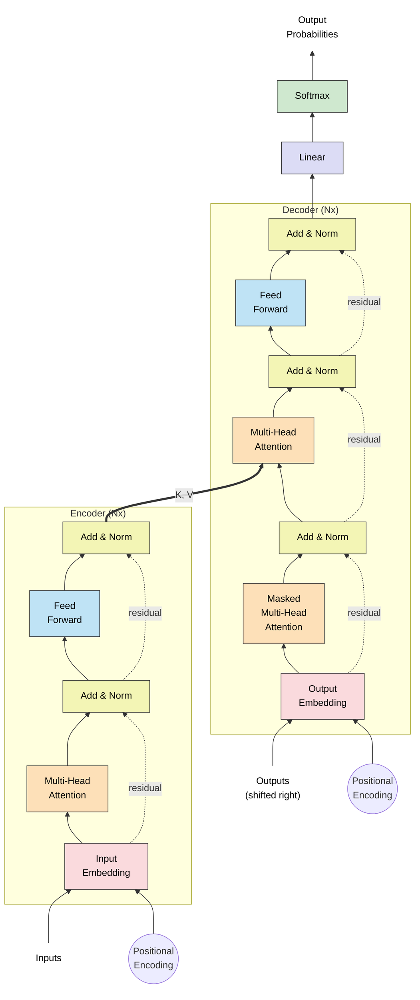

<div align = "center">

# Tranformer 

<p> <i> Building a tranformer model from scratch using <b>Pytorch</b> </i> </p>

</div>


## Project Setup
```shell
cd transformer/
python3 -m venv venv
source venv/bin/activate

pip install -r requirements.txt
```

## Transformer Architecture

